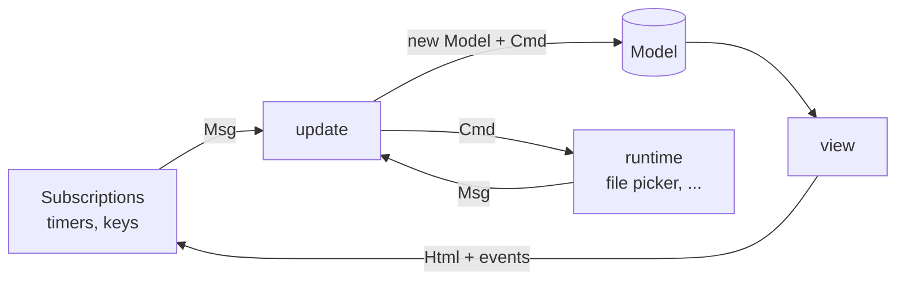
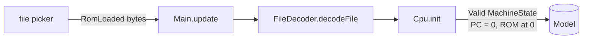
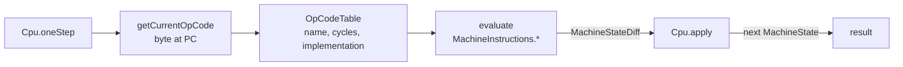
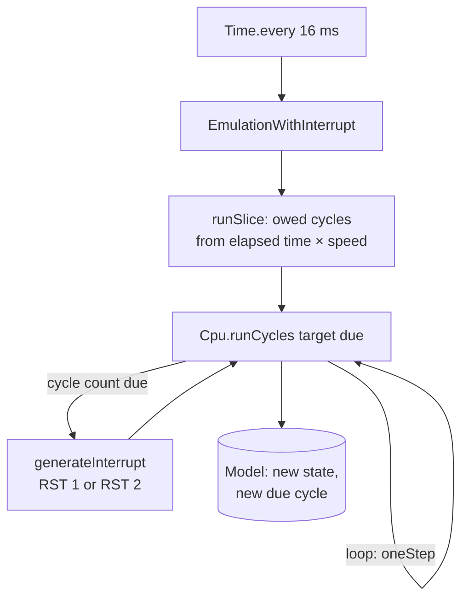
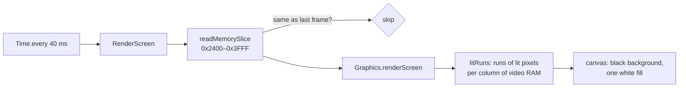
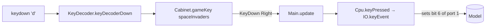

# Elmulator

An Intel 8080 emulator written in Elm 0.19.1

<div class="pt-8 text-sm opacity-70">
Emulation · the 8080 · functional programming and modelling · Elm · a walk-through of the code
</div>

<!--
Elmulator emulates the Intel 8080 processor, the CPU of Space Invaders (1978).
We will go from the general idea of emulation, to the chip, to the language and
the way we model it, and finish with the code of this project.
-->

---

# What we will cover

<div class="grid grid-cols-2 gap-8 pt-4">

<div>

1. **Emulation**: what it is, and what we must reproduce
2. **The Intel 8080**: registers, instructions, ports, interrupts
3. **Functional programming and modelling**: values, effects as data, and types that rule out wrong programs
4. **Elm**: the language and its architecture
5. **Walk-through**: from a ROM file to pixels on the screen

</div>

<div class="text-sm opacity-80">

Every part refers back to Elmulator, so you can see each idea in working code.

The repository: `github.com/SamuelBucheliZ/elmulator`

</div>

</div>

---
layout: section
---

# 1 · Emulation

What an emulator has to reproduce

---

# An emulator is a program that runs another machine's program

- **Host**: the machine running the emulator (here: a browser)
- **Guest**: the machine being emulated (here: an Intel 8080 and its Space Invaders cabinet)
- The guest's program is data for the emulator: it reads the bytes, one instruction at a time

Two families of technique:

- **Interpretation**: decode each instruction, then do what it says (Elmulator does this)
- **Translation** (JIT, recompilation): turn guest code into host code and run that

Interpretation is slower but simple to get exactly right, which matters when correctness is the goal.

---

# To be faithful, an emulator reproduces three things

| Concern | What the guest sees | Where it lives in Elmulator |
| --- | --- | --- |
| **State** | registers, flags, memory, ports | `EmulatorState.MachineState` |
| **Instructions** | what each opcode does, and how many cycles it takes | `OpCodeTable`, `MachineInstructions` |
| **Time** | the clock, and interrupts that come at fixed moments | `Config`, `Cpu.runCycles` |

Get any one of them slightly wrong and the game still runs, but it runs wrong:
the aliens do not move, or the shots never fire.

---

# The core loop: fetch, decode, execute

From `src/elm/Cpu.elm`:

```elm
oneStep : MachineState -> EmulatorState
oneStep cpuState =
    let
        opcode =
            getCurrentOpCode cpuState

        opCodeFromTable =
            getOpCodeFromTable opcode

        machineStateDiff =
            Maybe.withDefault (Failed (Just cpuState) "Error while getting OpCode")
                (Maybe.map (evaluate cpuState) opCodeFromTable)
    in
    apply machineStateDiff cpuState
```

<div class="text-sm opacity-70 pt-2">
Fetch the byte at the program counter, look it up, evaluate the instruction to a list of effects, apply them.
</div>

---

# Time: emulated clock, not wall clock

The 8080 runs at **2 MHz**: two million clock cycles per second.

- The emulator counts **cycles**, not instructions. Each opcode has a cost (4 to 18 cycles)
- The browser calls us every **16 ms**; we convert the elapsed time into owed cycles
- The video interrupt is due every **1/120 s** (60 frames, two interrupts each)

```elm
-- Main.elm: a slice of emulation
runSlice : Int -> Clock -> EmulatorState -> ( EmulatorState, Clock )
```

<div class="text-sm opacity-70 pt-2">
Running at 0.5x, the same program takes twice as long: the speed is a property of the clock, not of the CPU core.
</div>

---
layout: section
---

# 2 · The Intel 8080

The chip and the cabinet

---

# The chip in one slide

- Released in 1974, 8-bit data bus, 16-bit address bus: **64 KB** of memory
- **Accumulator A** and six general registers **B C D E H L**
- **Register pairs**: BC, DE, HL (and PSW = A with the flags); HL addresses memory
- **Stack pointer SP** and **program counter PC**, both 16 bits
- **Flags**: zero, sign, parity, carry, auxiliary carry

In Elmulator the registers are a record, with the flags as their own record:

```elm
type alias CpuState =
    { a : RegisterValue
    , b : RegisterValue
    , c : RegisterValue
    -- d, e, h, l, sp, pc
    , conditionCodes : ConditionCodes   -- z, s, p, cy, ac
    , intEnable : Flag
    , cycleCount : Int
    }
```

---

# About 250 opcodes, many of them families

The opcode is one byte. Its bits say what to do:

| Bits | Meaning | Example |
| --- | --- | --- |
| `01 ddd sss` | `MOV dst, src` (`0x40`–`0x7F`) | `0x78` = `MOV A,B` |
| `10 ooo rrr` | ALU op on A with a register | `0x80` = `ADD B` (4 cycles) |
| `11 ccc 010` | `Jcc` conditional jump | `0xCA` = `JZ` |
| `11 nnn 111` | `RST n` (call a fixed vector) | `0xCF` = `RST 1` |

In `OpCodeTable.elm` the families are **generated from these bits**, instead of
being written out one by one.

---

# Ports: how the outside world is reached

`IN` and `OUT` talk to devices through numbered ports. Space Invaders uses:

- **Port 1**: input buttons: coin, 2P start, 1P start, fire, left, right
- **Port 2**: input: more settings (the emulator keeps the default)
- **Output ports 2 and 4**: the **shift register**, a hardware helper that
  shifts a byte through a 16-bit window; the game uses it to draw sprites

In Elmulator the buttons are bits of `ports.one`:

```elm
-- IO.elm
keyEvent : Bool -> GameKey -> MachineState -> MachineStateDiff
```

---

# Interrupts: the game's heartbeat

The 8080 interrupts when a device asks it to. The game runs on the **video interrupt**:

- The video hardware raises **RST 1** at mid-frame and **RST 2** at the end of the frame
- The interrupt jumps to a fixed address (8 × n) and disables further interrupts
- The game re-enables interrupts (`EI`) in its handler

Elmulator alternates them, every 1/120 s:

```elm
-- Cpu.elm: the vector due in this slice
modBy 2 (nextInterruptDue // interruptPeriodCycles) == 1
```

<div class="text-sm opacity-70 pt-2">
Our first version only sent RST 2. The game re-enables interrupts in its RST 1 handler, so the aliens stopped moving after the first frame. Alternating the two vectors fixed it.
</div>

---

# The screen is just memory

Space Invaders has a **monochrome** display of 224 × 256 pixels, rotated 90°.

- Video RAM is at **0x2400–0x3FFF** (7 KB)
- Each byte holds **8 pixels**, one per bit, in a vertical column
- The emulator reads the bytes and draws them; the game never talks to a graphics card

```elm
-- Main.elm, every 40 ms
readMemorySlice 0x2400 0x3FFF machineState.memory
```

---
layout: section
---

# 3 · Functional programming

Values, effects as data, and types that rule out wrong programs

---

# A function is a value-in, value-out relation

```elm
evaluate : MachineState -> OpCode -> MachineStateDiff
```

- The same machine state and opcode always give the same result
- Nothing is changed in place: the state we were given stays as it was
- There is no hidden input (no global memory, no clock) inside the core

Why this matters for an emulator: **we can test an instruction without a browser**,
by building a state and checking the result. 167 unit tests run in about a second.

---

# Immutable records and updates

Elm records are values. Updating a field makes a new record:

```elm
withCpuState : EmulatorState -> Model -> Model
withCpuState cpuState model =
    let
        machine =
            model.machine
    in
    { model | machine = { machine | currentCpuState = cpuState } }
```

The old model still exists, unchanged. That is the foundation for **stepping**:
a history of states is just a list of values, and going back is taking an earlier element.

---

# Effects as data

An instruction does not change the machine. It **describes** what should change:

```elm
-- IO.io_in: the instruction IN 1
Events
    [ SetCpu (SetRegisterA machineState.ports.one)
    , SetCpu (SetPC newPc)
    ]
```

`Cpu.apply` interprets that list, one event at a time, and produces the next state.

- A test can check the **description**, without running anything
- The events are the same kind of thing whether they come from the CPU or a device
- The list is small and closed: the set of event types is the set of ways a machine can change

---

# Errors as values, not exceptions

An instruction that cannot run (an unknown opcode, say) does not throw:

```elm
type EmulatorState
    = Valid MachineState
    | Invalid (Maybe MachineState) String
```

- The caller must handle `Invalid`, because the type says it can happen
- `Invalid` keeps the last known machine state, so the screen can still show something useful
- There are no exceptions to forget about: a missing case is a compile error

---

# Recursion and folds, not loops

There are no `for` or `while` loops in the core. Repetition is a fold or a recursion:

```elm
-- Cpu.nStep: run n instructions
nStep : Int -> MachineState -> EmulatorState
```

```elm
-- tests: run a list of slices over the model
List.foldl (\i model -> Tuple.first (update (EmulationWithInterrupt ...) model)) model times
```

<div class="text-sm opacity-70 pt-2">
Elm has no loops, so iteration is a function that calls itself on a smaller problem. The compiler turns the tail calls into loops.
</div>

---
layout: section
---

# 3 · Modelling with types

Make illegal states unrepresentable

---

# The idea

If the types describe the machine correctly, many mistakes cannot be written at all.

- Give every **concept** a type: a register, an operand, a button, an event
- Make the **combinations** that do not exist impossible to express
- Let the compiler check that every case is handled
- Keep the **effects** as data, so the logic stays testable

<div class="text-sm opacity-70 pt-2">
The compiler checks the model. Tests check what the compiler cannot: the numbers, the timing and the behaviour of the chip.
</div>

---

# Concept: a register is one of seven names

The 8080 encodes operands in a 3-bit field: `0`=B, `1`=C … `6`=(HL), `7`=A.
We convert the bits once, into a type:

```elm
type Register
    = B | C | D | E | H | L | A

type Operand
    = Reg Register
    | AtHL          -- the byte at the address in HL
```

```elm
operandFromCode : Int -> Operand
```

<div class="text-sm opacity-70 pt-2">
After the conversion, a number from 0 to 7 never reaches an instruction. An instruction that takes an `Operand` cannot be handed a register pair, and the `AtHL` case cannot be forgotten: the `case` must mention it.
</div>

---

# Concept: a register pair is not a register

```elm
type Pair
    = PairBC
    | PairDE
    | PairHL
    | PairSP        -- not a register, but it takes part in pair operations
```

- `INX`, `DCX`, `LXI` and `DAD` take a `Pair`, not an `Operand`
- SP is in the `Pair` type, so the stack pointer takes part in `DAD SP` without a special case in every instruction
- The 2-bit field is converted once, by `pairFromCode`

---

# Concept: an opcode's length is its type

```elm
type OpCodeSpec
    = OneByte ImplOneByte
    | TwoBytes ImplTwoBytes
    | ThreeBytes ImplThreeBytes
```

Each table entry says how many bytes the instruction takes, and the implementation has the
matching shape:

- A one-byte instruction (`MOV A,B`) is a `OneByte`, with no operand bytes
- A two-byte instruction (`ADI D8`) is a `TwoBytes`, and its implementation takes one operand byte
- An implementation for `TwoBytes` cannot be put into a `OneByte` slot

`getOpCodeLength` reads the length from the constructor, so the length is written only once.

---

# Concept: a closed set of effects

Everything an instruction can do is one of these:

```elm
type MachineStateDiffEvent
    = SetCpu SetCpuStateEvent
    | SetMemory AddressValue ByteValue
    | SetShiftRegister SetShiftRegisterEvent
    | SetPort SetPortEvent
```

```elm
applyEvent : MachineStateDiffEvent -> MachineState -> MachineState
applyEvent event machineState =
    case event of
        SetMemory address value -> ...
        SetCpu setCpuStateEvent -> ...
```

<div class="text-sm opacity-70 pt-2">
Add a new kind of effect and the compiler lists every `case` that has no catch-all branch and must handle it. The same holds for the messages of the page (`UI/Msg.elm`).
</div>

---

# Concept: a button is a value, not a key

A keyboard key becomes a game button in one place, through a value we can test:

```elm
type GameKey = Left | Right | Fire | Coin | Start1 | Start2

gameKey : Cabinet -> String -> Maybe GameKey
```

- `Cabinet.spaceInvaders` is the key map: `"a"` → `Left`, `"d"` → `Right`, …
- `IO.keyEvent` is the only place that knows which bit of port 1 a button drives
- An unknown key gives `Nothing`, so the browser's own keys (space, arrows) never reach the game

```elm
test "keys that are not game buttons have no meaning" ...
```

---

# Concept: time is an input

The emulated clock is not read inside the core. It is passed in:

```elm
runCycles : Int -> Int -> MachineState -> ( EmulatorState, Int )
--          target  due   state          new state, new due cycle
```

- The caller decides how far to run, and keeps the next interrupt cycle
- The function is pure: the same inputs always give the same cycles
- Tests can run an exact number of cycles, without waiting for a browser timer

---

# Concept: the model is made of parts

```elm
type alias Model =
    { machine : Machine     -- the ROM and the emulated 8080
    , clock : Clock         -- speed, pause, emulated time
    , ui : Ui               -- what is shown: step box, code view, screen
    }
```

- The page cannot change the CPU except through `update`, with a message
- The clock can be tested without the screen, and the screen without the machine
- A cache (the last rendered frame) lives in the UI part, where it belongs

---

# What the types do not catch yet

Honest version: `ByteValue` and `AddressValue` are **aliases** for `Int`.

```elm
type alias ByteValue =
    Int

type alias AddressValue =
    Int
```

So the compiler accepts an address where a byte is expected. Our tests and the ROM tests catch
most such slips, but the types could do more.

A possible next step: **opaque types** for byte and address, created by smart constructors that
wrap and check the value, so the two cannot be mixed without an explicit conversion. This is
not in the code yet.

---

# Summary: how we modelled the emulator

1. **Name the concept** (a register, a button, an effect)
2. **Give it a type**, and convert from raw numbers once, at the edge
3. **Make the impossible combinations impossible** (operand vs pair, opcode length)
4. **Describe effects as data**, and apply them in one place
5. **Pass time and input in**, so the core stays pure
6. **Test the functions**, not the browser; let the compiler check the rest

---
layout: section
---

# 4 · Elm

A typed, pure language for web front ends

---

# Elm in one slide

- A functional language that **compiles to JavaScript**; the browser runs the result
- **Statically typed**, with type inference: most annotations are optional, but good code has them
- **No runtime exceptions** by design: the compiler checks every case you handle
- **No side effects in functions**: effects happen only through `Cmd` and `Sub`
- Ships with the **Elm Architecture**: a model, a message type, an update, a view

Elmulator uses Elm 0.19.1, with `elm-canvas` for drawing and `elm-bootstrap` for the controls.

---

# The Elm Architecture

<div class="flex justify-center">



</div>

Everything the browser does enters as a **message**. The model is updated only in `update`.
The view is a function of the model.

---

# Messages describe what happened

`src/elm/UI/Msg.elm` is the list of things that can happen in the app:

```elm
type Msg
    = RomRequested
    | RomLoaded Bytes
    | KeyDown GameKey
    | KeyUp GameKey
    | EmulationWithInterrupt Time.Posix
    | RenderScreen Time.Posix
    | SpeedSelected Float
    | TogglePause
    -- ...
```

A new feature usually means a new constructor here, and the compiler then shows every `case` that must handle it.

---

# Subscriptions: the outside world, as messages

```elm
subscriptions : Model -> Sub Msg
subscriptions _ =
    Sub.batch
        [ Browser.Events.onKeyDown keyDecoderDown
        , Browser.Events.onKeyUp keyDecoderUp
        , Time.every 40 RenderScreen
        , Time.every sliceInterval EmulationWithInterrupt
        ]
```

A timer, a keyboard event and a file load are all just messages. `update` treats them the same way.

---
layout: section
---

# 5 · Walk-through

From the ROM file to pixels on the screen

---

# The repository, by layer

| Layer | Modules | Nature |
| --- | --- | --- |
| CPU core | `Cpu`, `MachineInstructions`, `OpCodeTable`, `Registers`, `Memory`, `Psw` | pure functions of the machine state |
| Devices | `IO` (ports and buttons), `Graphics` (video RAM to drawing commands) | pure |
| Timing | `Config`, `Cpu.runCycles` | pure: cycles in, state out |
| Cabinet | `Cabinet` (keys and power-on ports of Space Invaders) | a value |
| Shell | `Main`, `UI.*` | the Elm runtime: messages, views |

The core and the devices know nothing about the browser. Everything that touches the browser goes through `Main`.

---

# Walk-through 1: loading a ROM



- `FileDecoder` turns the `Bytes` into a list of byte values
- `Cpu.init` places them in memory and sets up the registers, flags and ports
- The clock keeps the speed and the start-paused setting, and restarts from cycle zero

---

# Walk-through 2: one instruction



For `ADD B` (`0x80`): the table gives the family implementation, which reads A and B,
returns events `SetCpu (SetRegisterA ...)` and the flags, plus `AddCycles 4`.
`apply` folds them into the next state.

---

# Walk-through 3: the clock



`runCycles` runs instructions until the target is reached, and raises the interrupts that fall due on the way.
Its inputs and outputs are values: the caller keeps the due cycle, so the function stays pure.

---

# Walk-through 4: the screen



If video RAM did not change, the frame is not redrawn. The canvas is 224 × 256 and scaled by CSS with pixelated rendering.

---

# Walk-through 5: a key press



The keys are `A` `D` `S` `C` `1` `2`. Arrow keys, space and enter are not used, so the page does not scroll.
A key that is typed into a text field is ignored.

---
layout: end
---

# Try it out

Play Space Invaders in the browser:
`samuelbucheliz.github.io/elmulator`

Read the code, starting with the types:

- `src/elm/Registers.elm`: registers and pairs as types
- `src/elm/Cabinet.elm`: buttons and keys as values
- `src/elm/Cpu.elm`: the core loop and `runCycles`

Run the tests: `npm test` (about a second) and `npm run test:slow` (the CP/M ROMs)

Repository: `github.com/SamuelBucheliZ/elmulator`
