# Elmulator

An Intel 8080 emulator, written in Elm

<div class="pt-8 text-sm opacity-70">
Emulation · the 8080 · functional programming and modelling · a walk-through of the code
</div>

<!--
Elmulator emulates the Intel 8080 processor, the CPU of Space Invaders (1978).
We start with the general idea of emulation, then the chip, then how we model it
in a functional language, and finish with the code of this project.
-->

---

# What we will cover

<div class="grid grid-cols-2 gap-8 pt-4">

<div>

1. **Words we will use**: a short glossary
2. **Emulation**: what it is, and what we must reproduce
3. **The Intel 8080**: registers, instructions, ports, interrupts, the clock, the screen
4. **Functional programming and modelling**: values, effects as data, and types that rule out wrong programs
5. **Elm**: the language and its architecture
6. **Walk-through**: from a ROM file to pixels on the screen, with the code for each step

</div>

<div class="text-sm opacity-80">

Every part refers back to Elmulator, so you can see each idea in working code.

The repository: `github.com/SamuelBucheliZ/elmulator`

</div>

</div>

---

# Words we will use

<div class="glossary">

| Word | Meaning |
| --- | --- |
| **ROM** | the program and data of a game; here, the file you load |
| **Opcode** | the first byte of an instruction: the number that says which operation to run |
| **Register** | a small storage cell inside the CPU, 8 bits wide |
| **Flag** | one bit of the CPU that says something about the last result (zero, sign, carry, …) |
| **Memory** | 64 KB of bytes, numbered 0 to 65535; the screen is part of it |
| **Program counter (PC)** | the address of the next byte to run |
| **Port** | a numbered channel to a device: `IN` reads it, `OUT` writes it |
| **Interrupt** | a signal that makes the CPU pause its program and jump to a handler; explained in section 2 |
| **Cycle** | one tick of the CPU's clock; a 2 MHz clock ticks two million times per second |
| **Pure function** | a function whose result depends only on its arguments |
| **Union type** | a type that is exactly one of several named cases |
| **Record** | a value with named fields, such as `{ a = 1, b = 2 }` |

</div>

---
layout: section
---

# 1 · Emulation

What an emulator has to reproduce

---

# An emulator runs another machine's program

<div class="grid grid-cols-2 gap-8">

<div>

- **Host**: the machine running the emulator (here: a browser)
- **Guest**: the machine being emulated (here: an Intel 8080 and its Space Invaders cabinet)
- The guest's program is just data for the emulator: it reads the bytes, one instruction at a time

</div>

<div>

Two families of technique:

- **Interpretation**: decode each instruction, then do what it says. Elmulator does this.
- **Translation** (JIT, recompilation): turn guest code into host code and run that

Interpretation is slower, but simple to get exactly right.

</div>

</div>

<div class="diagram diagram-row">

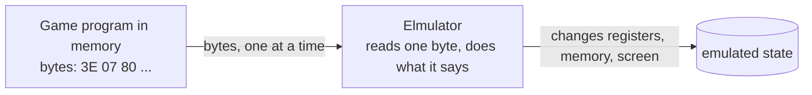

</div>

---

# To be faithful, an emulator reproduces three things

| Concern | What the guest sees | Where it lives in Elmulator |
| --- | --- | --- |
| **State** | registers, flags, memory, ports | `EmulatorState.MachineState` |
| **Instructions** | what each opcode does, and how many cycles it takes | `OpCodeTable`, `MachineInstructions` |
| **Time** | the clock, and interrupts that come at fixed moments | `Config`, `Cpu.runCycles` |

Get any one of them slightly wrong and the game still runs, but it runs wrong:
the aliens do not move, or the shots never fire.

---
layout: section
---

# 2 · The Intel 8080

The chip, its registers, and the cabinet around it

---

# The chip

<div class="grid grid-cols-2 gap-8 items-center">

<div>

- Released in 1974, an **8-bit** processor: it moves one byte at a time
- The address bus is **16 bits**: it can address **64 KB** of memory
- Clocked at **2 MHz** in Space Invaders
- About 250 documented **opcodes**
- Pins for the data, address and control signals, and for the ports (`IN`, `OUT`)

</div>

<div class="flex items-center justify-center gap-4">

<figure>

<figcaption class="credit">Photo: The Science Museum UK, CC BY 4.0, via Wikimedia Commons (“Intel 8080 open-closed”). Left: the closed package. Right: the package opened, showing the die.</figcaption>
</figure>

<figure>

<figcaption class="credit">Pinout: Wikimedia Commons, CC0 (by NoahSPARC).</figcaption>
</figure>

</div>

</div>

---

# Registers: the CPU's small, fast storage

<div class="grid grid-cols-2 gap-6 items-center">

<div class="reg-diagram">
<div class="reg-row">
<div class="reg-box reg-main"><b>A</b><span>accumulator</span></div>
<div class="reg-box"><b>B C</b><span>general</span></div>
<div class="reg-box"><b>D E</b><span>general</span></div>
<div class="reg-box"><b>H L</b><span>address in memory</span></div>
<div class="reg-box"><b>SP</b><span>stack pointer</span></div>
<div class="reg-box"><b>PC</b><span>next byte to run</span></div>
</div>
<div class="reg-arrow">operands and results ↕</div>
<div class="reg-alu">ALU: add, and, compare, …</div>
<div class="reg-arrow">sets ↓</div>
<div class="reg-row">
<div class="reg-box reg-flags"><b>flags</b><span>Z S P CY AC</span></div>
</div>
<div class="reg-note">H L and PC give the addresses used to read and write memory (64 KB)</div>
</div>

<div class="code-small">

Elmulator keeps them in a record:

```elm
-- src/elm/EmulatorState.elm
type alias CpuState =
    { a : RegisterValue
    , b : RegisterValue
    , c : RegisterValue
    -- d, e, h, l, sp, pc
    , conditionCodes : ConditionCodes  -- z, s, p, cy, ac
    , intEnable : Flag
    , cycleCount : Int
    }
```

</div>

</div>

---

# Instructions: an opcode says what to do

The opcode is one byte. Its bits describe the operation, so many opcodes are one **family**:

| Bits | Meaning | Example |
| --- | --- | --- |
| `01 ddd sss` | `MOV dst, src` (`0x40`–`0x7F`) | `0x78` = `MOV A,B` |
| `10 ooo rrr` | ALU operation on A with a register | `0x80` = `ADD B`, 4 cycles |
| `11 ccc 010` | `Jcc`: jump if a flag has a value | `0xCA` = `JZ` (jump if zero) |
| `11 nnn 111` | `RST n`: call the fixed address `8 × n` | `0xCF` = `RST 1` |

In `OpCodeTable.elm` these families are **generated from the bits**, instead of being written out one by one.

---

# The core loop: fetch, decode, execute

<div class="grid grid-cols-2 gap-6 items-center">

<div class="diagram">

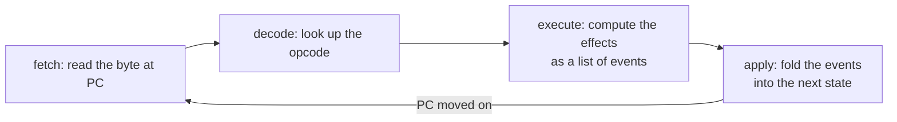

</div>

<div class="code-small">

```elm
-- src/elm/Cpu.elm
oneStep : MachineState -> EmulatorState
oneStep cpuState =
    let
        opcode =
            getCurrentOpCode cpuState

        opCodeFromTable =
            getOpCodeFromTable opcode

        machineStateDiff =
            Maybe.withDefault (Failed (Just cpuState) "Error while getting OpCode")
                (Maybe.map (evaluate cpuState) opCodeFromTable)
    in
    apply machineStateDiff cpuState
```

</div>

</div>

---

# Ports: how the outside world is reached

`IN` and `OUT` talk to devices through numbered **ports**. Space Invaders uses:

- **Port 1 (input)**: the buttons: coin, 2P start, 1P start, fire, left, right, one bit each
- **Port 2 (input)**: more settings; the emulator keeps the default
- **Output ports 2 and 4**: the **shift register**, a hardware helper that shifts bytes through a 16-bit window; the game uses it to draw sprites

<div class="grid grid-cols-2 gap-6 items-center pt-2">

<div class="diagram">

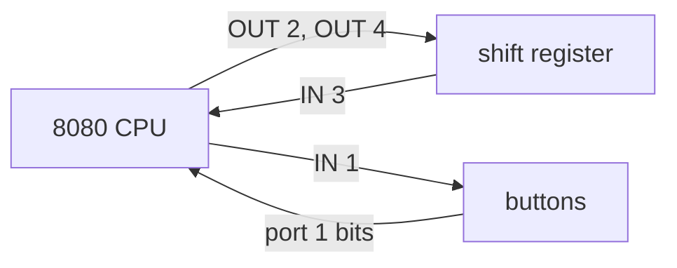

</div>

<div class="code-small">

```elm
-- src/elm/IO.elm: the button is a bit of port 1
keyEvent : Bool -> GameKey -> MachineState -> MachineStateDiff
keyEvent pressed key machineState =
    case key of
        Left ->
            portOneEvent pressed 0x20 machineState
        ...
```

</div>

</div>

---

# What is an interrupt?

<div class="grid grid-cols-2 gap-6 items-center">

<div>

Normally the CPU runs one instruction after another. A device can **interrupt** that:

1. The device raises a request
2. The CPU finishes the instruction it is on
3. It pushes the return address onto the **stack** (a region of memory it uses for calls)
4. It jumps to a fixed handler address, and disables further interrupts
5. The handler ends with `RET`, and the program continues where it was

`RST n` is the one-byte call to the handler: it goes to address `8 × n`. `EI` enables interrupts again, `DI` disables them.

</div>

<div class="diagram">

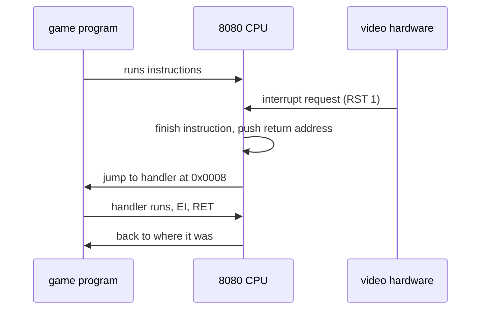

</div>

</div>

---

# Space Invaders' heartbeat: two interrupts per frame

The video hardware raises an interrupt **twice per frame**, and the game depends on both:

- **RST 1** at mid-frame
- **RST 2** at the end of the frame

Together they run at 60 frames per second: one interrupt every 1/120 s, which is **16,667 cycles** at 2 MHz.

The game turns interrupts back on only in its RST 1 handler, so we must send them alternately:

```elm
-- src/elm/Cpu.elm: which vector is due
if modBy 2 (nextInterruptDue // interruptPeriodCycles) == 1 then
    1
else
    2
```

<div class="text-sm opacity-70 pt-2">
Our first version only sent RST 2. The aliens stopped moving after the first frame, because interrupts stayed off. Alternating the two vectors fixed it.
</div>

---

# Clock and cycles: emulated time

- The CPU runs at **2 MHz**: two million cycles per second. An opcode costs 4 to 18 cycles (`ADD B` costs 4)
- The emulator counts **cycles**, not instructions, so the interrupts land at the right moments
- The browser calls us about every **16 ms**; we turn the elapsed time into **owed cycles**

```elm
-- src/elm/Main.elm, runSlice (excerpt)
owed =
    clock.cycleRemainder + baseCyclesPerSecond * clock.speedFactor * toFloat elapsed / 1000
```

<div class="text-sm opacity-70 pt-2">
At speed 0.5x the same program takes twice as long: the speed is a property of the clock, not of the CPU.
</div>

---

# The screen is just memory

Space Invaders has a **monochrome** screen of 224 × 256 pixels. Its picture lives in memory at **0x2400–0x3FFF**:

- Each **bit** is one pixel: 1 is lit, 0 is dark
- Each **byte** is eight pixels in a vertical column
- A row of the screen is 32 bytes, so 256 pixels

<div class="flex items-center justify-center gap-10 pt-4">

<div class="text-center">
<div class="text-sm opacity-70 pb-1">the byte <code>0xA6</code> = <code>1010 0110</code></div>
<div class="pixel-column">
  <div class="on"></div>
  <div></div>
  <div class="on"></div>
  <div></div>
  <div></div>
  <div class="on"></div>
  <div class="on"></div>
  <div></div>
</div>
</div>

<div class="text-sm">

The emulator reads that memory and draws it; the game never talks to a graphics card.

```elm
-- src/elm/Main.elm, every 40 ms
readMemorySlice 0x2400 0x3FFF machineState.memory
```

</div>

</div>

---
layout: section
---

# 3 · Functional programming

Values, effects as data, and errors as values

---

# A function is a value-in, value-out relation

```elm
evaluate : MachineState -> OpCode -> MachineStateDiff
```

- The same machine state and opcode always give the same result
- Nothing is changed in place: the state we were given stays as it was
- There is no hidden input (no global memory, no clock) inside the core

Why this matters for an emulator: **we can test an instruction without a browser**,
by building a state and checking the result. 167 unit tests run in about a second.

---

# Immutable records and updates

Elm records are values. Updating a field makes a new record:

```elm
withCpuState : EmulatorState -> Model -> Model
withCpuState cpuState model =
    let
        machine =
            model.machine
    in
    { model | machine = { machine | currentCpuState = cpuState } }
```

The old model still exists, unchanged. That is the foundation for **stepping**:
a history of states is just a list of values, and going back is taking an earlier element.

---

# Effects as data

An instruction does not change the machine. It **describes** what should change:

```elm
-- src/elm/IO.elm: the instruction IN 1
Events
    [ SetCpu (SetRegisterA machineState.ports.one)
    , SetCpu (SetPC newPc)
    ]
```

`Cpu.apply` interprets that list, one event at a time, and produces the next state.

- A test can check the **description**, without running anything
- The events are the same kind of thing whether they come from the CPU or a device
- The list is small and closed: the event types are the ways a machine can change

---

# Errors as values, not exceptions

An instruction that cannot run (an unknown opcode, say) does not throw:

```elm
type EmulatorState
    = Valid MachineState
    | Invalid (Maybe MachineState) String
```

- The caller must handle `Invalid`, because the type says it can happen
- `Invalid` keeps the last known machine state, so the screen can still show something useful
- There are no exceptions to forget about: a missing case is a compile error

---

# Recursion and folds, not loops

There are no `for` or `while` loops in the core. Repetition is a fold or a recursion:

```elm
-- src/elm/Cpu.elm: run n instructions
nStep : Int -> MachineState -> EmulatorState
```

```elm
-- tests: run a list of slices over the model
List.foldl (\i model -> Tuple.first (update (EmulationWithInterrupt ...) model)) model times
```

<div class="text-sm opacity-70 pt-2">
Elm has no loops, so iteration is a function that calls itself on a smaller problem. The compiler turns those self-calls into loops.
</div>

---
layout: section
---

# 3 · Modelling with types

Make illegal states unrepresentable

---

# The idea

If the types describe the machine correctly, many mistakes cannot be written at all.

- Give every **concept** a type: a register, an operand, a button, an effect
- Make the **combinations** that do not exist impossible to express
- Let the compiler check that every case is handled
- Keep the **effects** as data, so the logic stays testable

<div class="text-sm opacity-70 pt-2">
The compiler checks the model. Tests check what the compiler cannot: the numbers, the timing and the behaviour of the chip.
</div>

---

# Contrast: a register as a plain string

<div class="grid grid-cols-2 gap-6">

<div class="code-small">

**The plain-string model**

```elm
setRegister : String -> Int -> CpuState -> CpuState
setRegister name value cpu =
    case name of
        "A" -> { cpu | a = value }
        "B" -> { cpu | b = value }
        _ -> cpu     -- unknown names: silently ignored


setRegister "a" 5 cpu  -- compiles, does nothing
```

</div>

<div class="code-small">

**The union-type model**

```elm
type Register
    = A | B | C | D | E | H | L


setRegister : Register -> Int -> CpuState -> CpuState
setRegister register value cpu =
    case register of
        A -> { cpu | a = value }
        B -> { cpu | b = value }
        ...


setRegister a 5 cpu  -- compile error: `a` is not defined
```

</div>

</div>

<div class="text-sm opacity-80 pt-3">
With strings, a typo is a silent bug, found only if a test happens to cover it. With the union type, the typo does not compile, and a forgotten register is a compile error at the `case`.
</div>

---

# Concept: an operand is a register or memory

The 8080 encodes operands in a 3-bit field: `0`=B, `1`=C … `6`=(HL), `7`=A. We convert the bits **once**:

```elm
-- src/elm/Registers.elm
type Operand
    = Reg Register
    | AtHL          -- the byte at the address in HL
```

```elm
operandFromCode : Int -> Operand
```

<div class="text-sm opacity-80 pt-2">
After the conversion, a number from 0 to 7 never reaches an instruction. An instruction that takes an <code>Operand</code> cannot be handed a register pair, and the <code>AtHL</code> case cannot be forgotten: the <code>case</code> must mention it.
</div>

---

# Concept: a register pair is not a register

```elm
-- src/elm/Registers.elm
type Pair
    = PairBC
    | PairDE
    | PairHL
    | PairSP        -- not a register, but it takes part in pair operations
```

- `INX`, `DCX`, `LXI` and `DAD` take a `Pair`, not an `Operand`
- SP is in the `Pair` type, so `DAD SP` needs no special case in the instruction
- The 2-bit field is converted once, by `pairFromCode`

---

# Concept: an opcode's length is its type

```elm
-- src/elm/OpCode.elm
type OpCodeSpec
    = OneByte ImplOneByte
    | TwoBytes ImplTwoBytes
    | ThreeBytes ImplThreeBytes
```

<div class="grid grid-cols-2 gap-6">

<div class="text-sm">

- `MOV A,B` is a `OneByte`: no operand bytes
- `ADI D8` is a `TwoBytes`: its implementation takes one operand byte
- An implementation for `TwoBytes` cannot be put into a `OneByte` slot

</div>

<div class="text-sm">

**The alternative**: a length number next to the function, as `{ length = 2, run = ... }`. Nothing checks that the number matches the function, so a wrong length moves the program counter wrongly, and nothing says so.

</div>

</div>

<div class="text-sm opacity-70 pt-2">
<code>getOpCodeLength</code> reads the length from the constructor, so it is written only once.
</div>

---

# Contrast: flags as bits in an integer

<div class="grid grid-cols-2 gap-6">

<div class="code-small">

**Bits in one `Int`**

```elm
flagZ = 0x40
flagCY = 0x01

isZero flags =
    Bitwise.and flags 0x04 /= 0   -- wrong bit, compiles fine
```

</div>

<div class="code-small">

**A record of named flags**

```elm
-- src/elm/EmulatorState.elm
type alias ConditionCodes =
    { z : Flag
    , s : Flag
    , p : Flag
    , cy : Flag
    , ac : Flag
    }


isZero cc =
    cc.z           -- a Bool, nothing to mask
```

</div>

</div>

<div class="text-sm opacity-80 pt-3">
The bit version has the masks spread through the code, and a mask typed wrongly is still a valid `Int`. The record names each flag, and reading one gives a `Bool`.
</div>

---

# Concept: a closed set of effects

Everything an instruction can do is one of these:

```elm
-- src/elm/EmulatorState.elm
type MachineStateDiffEvent
    = SetCpu SetCpuStateEvent
    | SetMemory AddressValue ByteValue
    | SetShiftRegister SetShiftRegisterEvent
    | SetPort SetPortEvent
```

```elm
-- src/elm/Cpu.elm
applyEvent : MachineStateDiffEvent -> MachineState -> MachineState
applyEvent event machineState =
    case event of
        SetMemory address value -> ...
        SetCpu setCpuStateEvent -> ...
```

<div class="text-sm opacity-70 pt-2">
Add a new kind of effect and the compiler lists every <code>case</code> without a catch-all branch that must handle it. The same holds for the messages of the page (<code>UI/Msg.elm</code>).
</div>

---

# Concept: a button is a value, not a key

A keyboard key becomes a game button in one place, through a value we can test:

```elm
-- src/elm/Cabinet.elm
type GameKey = Left | Right | Fire | Coin | Start1 | Start2

gameKey : Cabinet -> String -> Maybe GameKey
```

<div class="grid grid-cols-2 gap-6">

<div class="text-sm">

**Keys as raw strings** would look like `KeyDown "d"` in `update`. A capital `"D"` or a typo does nothing, and nothing tells us.

</div>

<div class="text-sm">

**Keys as values**: `KeyDown Right`. An unknown key is `Nothing` and never reaches `update`. `IO.keyEvent` is the only place that knows which bit of port 1 a button drives.

</div>

</div>

---

# Concept: time is an input

The emulated clock is not read inside the core. It is passed in:

```elm
-- src/elm/Cpu.elm
runCycles : Int -> Int -> MachineState -> ( EmulatorState, Int )
--          target  due   state          new state, new due cycle
```

- The caller decides how far to run, and keeps the next interrupt cycle
- The function is pure: the same inputs always give the same cycles
- Tests can run an exact number of cycles, without waiting for a browser timer

---

# Concept: the model is made of parts

```elm
-- src/elm/Main.elm
type alias Model =
    { machine : Machine     -- the ROM and the emulated 8080
    , clock : Clock         -- speed, pause, emulated time
    , ui : Ui               -- what is shown: step box, code view, screen
    }
```

- The page cannot change the CPU except through `update`, with a message
- The clock can be tested without the screen, and the screen without the machine
- A cache (the last rendered frame) lives in the UI part, where it belongs

---

# What the types do not catch yet

Honest version: `ByteValue` and `AddressValue` are **aliases** for `Int`.

<div class="grid grid-cols-2 gap-6">

<div class="code-small">

**What we have**

```elm
-- src/elm/EmulatorState.elm
type alias ByteValue =
    Int

type alias AddressValue =
    Int

-- a byte where an address is expected:
-- the compiler accepts it
```

</div>

<div class="code-small">

**A possible next step** (not in the code yet)

```elm
type Byte
    = Byte Int   -- opaque: only the module can build one

toByte : Int -> Maybe Byte
toByte n =
    if n >= 0 && n <= 0xFF then Just (Byte n) else Nothing
```

</div>

</div>

<div class="text-sm opacity-80 pt-2">
Our tests and the ROM tests catch most such slips, but the types could do more.
</div>

---

# Summary: how we modelled the emulator

1. **Name the concept**: a register, an operand, a button, an effect
2. **Give it a type**, and convert from raw numbers once, at the edge
3. **Make the impossible combinations impossible**: operand against pair, opcode length
4. **Describe effects as data**, and apply them in one place
5. **Pass time and input in**, so the core stays pure
6. **Test the functions**, not the browser; let the compiler check the rest

---
layout: section
---

# 4 · Elm

A typed, pure language for web front ends

---

# Elm in one slide

- A functional language that **compiles to JavaScript**; the browser runs the result
- **Statically typed**, with type inference: most annotations are optional, but good code has them
- **No runtime exceptions** by design: the compiler checks every case you handle
- **No side effects in functions**: effects happen only through `Cmd` and `Sub`
- Ships with the **Elm Architecture**: a model, a message type, an update, a view

Elmulator uses Elm 0.19.1, with `elm-canvas` for drawing and `elm-bootstrap` for the controls.

---

# The Elm Architecture

<div class="diagram diagram-xl">

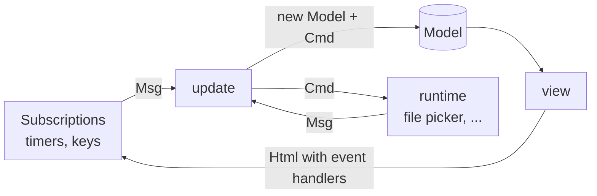

</div>

Everything the browser does enters as a **message**. The model is updated only in `update`. The view is a function of the model.

---

# Messages describe what happened

`src/elm/UI/Msg.elm` is the list of things that can happen in the app:

```elm
type Msg
    = RomRequested
    | RomLoaded Bytes
    | KeyDown GameKey
    | KeyUp GameKey
    | EmulationWithInterrupt Time.Posix
    | RenderScreen Time.Posix
    | SpeedSelected Float
    | TogglePause
    -- ...
```

A new feature usually means a new constructor here, and the compiler then shows every `case` that must handle it.

---

# Subscriptions: the outside world, as messages

```elm
-- src/elm/Main.elm
subscriptions : Model -> Sub Msg
subscriptions _ =
    Sub.batch
        [ Browser.Events.onKeyDown keyDecoderDown
        , Browser.Events.onKeyUp keyDecoderUp
        , Time.every 40 RenderScreen
        , Time.every sliceInterval EmulationWithInterrupt
        ]
```

A timer, a keyboard event and a file load are all just messages. `update` treats them the same way.

---
layout: section
---

# 5 · Walk-through

From the ROM file to pixels on the screen, with the code for each step

---

# The code, by component

<div class="grid grid-cols-2 gap-6 items-center">

<div class="diagram">

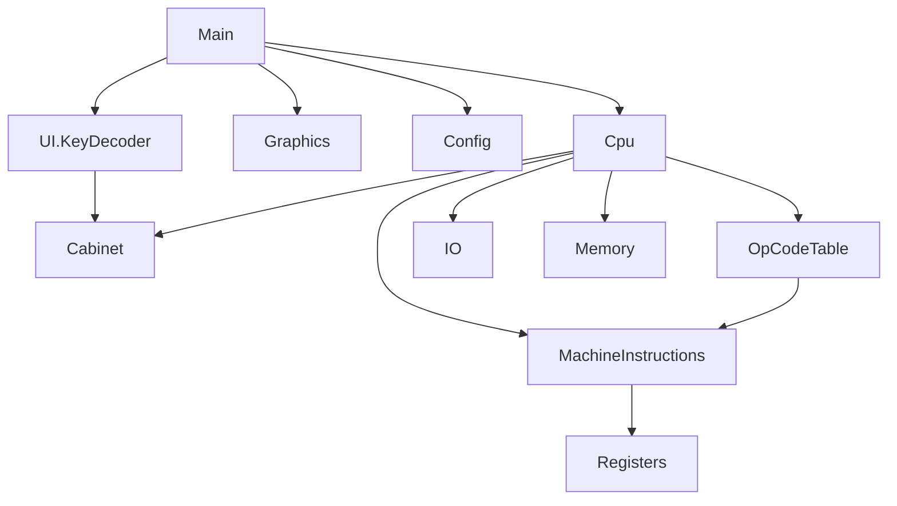

</div>

<div class="text-sm">

| Layer | Modules | Nature |
| --- | --- | --- |
| CPU core | `Cpu`, `MachineInstructions`, `OpCodeTable`, `Registers`, `Memory` | pure functions of the machine state |
| Devices | `IO` (ports, buttons), `Graphics` (video RAM to drawing commands) | pure |
| Timing | `Config`, `Cpu.runCycles` | pure: cycles in, state out |
| Cabinet | `Cabinet` (keys and power-on ports) | a value |
| Shell | `Main`, `UI.*` | the Elm runtime: messages and views |

</div>

</div>

---

# Walk-through 1: loading a ROM

<div class="diagram diagram-row">

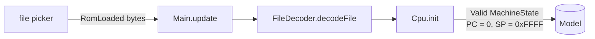

</div>

<div class="grid grid-cols-2 gap-4 code-small">

<div>

```elm
-- src/elm/Main.elm
RomLoaded content ->
    ( loadDataIntoMemory model content, Cmd.none )

loadDataIntoMemory model data =
    { machine =
        { data = Just data
        , currentCpuState = Cpu.init (decodeFile data)
        }
    , ...
```

</div>

<div>

```elm
-- src/elm/Cpu.elm (condensed)
init : List ByteValue -> EmulatorState
init rom =
    Valid
        (MachineState
            (CpuState 0x00 0x00 0x00 0x00 0x00 0x00 0x00  -- A B C D E H L
                0xFFFF 0x00 conditionCodes False 0)        -- SP, PC, flags, IE, cycles
            (initMemory rom) shiftRegister ports 0)
```

</div>

</div>

---

# Walk-through 2: fetch and evaluate one instruction

<div class="diagram diagram-row">

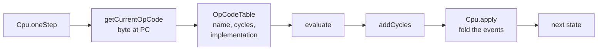

</div>

<div class="grid grid-cols-2 gap-4 code-small">

<div>

```elm
-- src/elm/Cpu.elm: evaluate (excerpt)
evaluate machineState opCode =
    let
        address = machineState.cpuState.pc
        firstValueProvider = createMemoryProvider address 1 memory
        secondValueProvider = createMemoryProvider address 2 memory
        implementation = getImplementation opCode firstValueProvider secondValueProvider
        cycles = getCycles opCode
    in
    implementation machineState
        |> addCycles cycles
```

</div>

<div>

```elm
-- src/elm/Cpu.elm: apply (excerpt)
apply machineStateDiff cpuState =
    case machineStateDiff of
        Failed maybePreviousState errorMessage ->
            Invalid maybePreviousState errorMessage

        Events machineStateDiffEvents ->
            Valid (List.foldl applyEvent { cpuState | step = newStep } machineStateDiffEvents)
```

</div>

</div>

---

# Walk-through 2b: ADD B, from opcode to flags

`0x80` is `ADD B`. Its table entry comes from the ALU family:

<div class="grid grid-cols-2 gap-4 code-small">

<div>

```elm
-- src/elm/OpCodeTable.elm: the ALU family (0x80–0xBF)
else if code < 0xC0 then
    Just
        (OpCodeData (aluName aluNames row ++ " " ++ registerName low)
            (if low == 6 then 7 else 4)                  -- cycles
            (OneByte (aluRegister row (operandFromCode low))))
```

```elm
-- src/elm/OpCodeTable.elm: row 0 is ADD
aluNames = [ "ADD", "ADC", "SUB", "SBB", "ANA", "XRA", "ORA", "CMP" ]
```

</div>

<div>

```elm
-- src/elm/MachineInstructions.elm
aluRegister operation source machineState =
    aluWith operation (operandValue source machineState) 1 machineState

aluWith operation value size machineState =
    Events (aluEvents operation value machineState
            ++ [ setPC (nextPc size machineState) ])

-- aluEvents, operation 0 (ADD)
0 ->
    let ( result, cy, ac ) = addWithCarry a value 0
    in withResult result cy ac
```

```elm
-- addWithCarry: the sum, the carry out, and the carry from bit 3
addWithCarry a b carryIn =
    ( modBy 256 sum, sum > 0xFF, ... )
```

</div>

</div>

---

# Walk-through 3: the clock and the interrupts

<div class="diagram diagram-row">

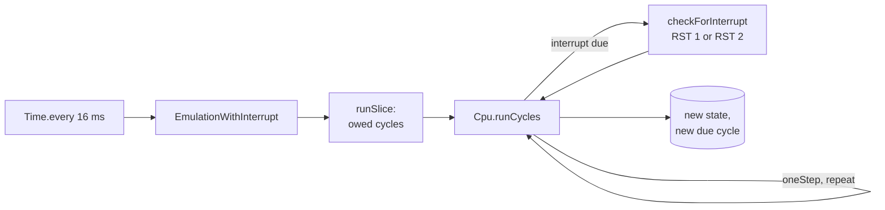

</div>

<div class="grid grid-cols-2 gap-4 code-small">

<div>

```elm
-- src/elm/Main.elm: runSlice (excerpt)
owed =
    clock.cycleRemainder + baseCyclesPerSecond * clock.speedFactor * toFloat elapsed / 1000

cyclesToRun = floor owed
( newCpuState, nextInterruptDue ) =
    runCycles (cyclesBefore + cyclesToRun) clock.nextInterruptDue currentCpuState
```

</div>

<div>

```elm
-- src/elm/Cpu.elm: runCycles (excerpt)
runCycles targetCycles nextInterruptDue machineState =
    if machineState.cpuState.cycleCount >= targetCycles then
        ( Valid machineState, nextInterruptDue )
    else
        case oneStep machineState of
            Valid next ->
                if next.cpuState.cycleCount >= nextInterruptDue then
                    ...  -- RST 1 or RST 2, then continue
```

</div>

</div>

---

# Walk-through 4: from video memory to pixels

<div class="diagram diagram-row diagram-row-small">

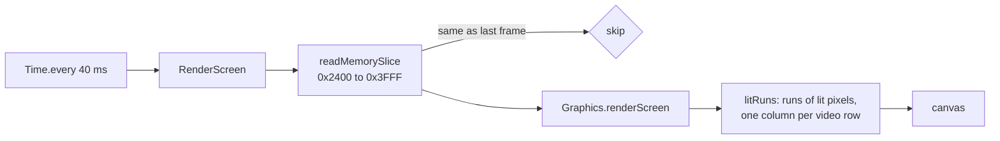

</div>

<div class="grid grid-cols-2 gap-4 code-small">

<div>

```elm
-- src/elm/Main.elm: RenderScreen (excerpt)
RenderScreen _ ->
    -- frame = readMemorySlice 0x2400 0x3FFF memory
    if model.ui.lastFrame == Just frame then
        ( model, Cmd.none )     -- unchanged: no redraw
    else
        ...                     -- keep renderFrame frame
```

</div>

<div>

```elm
-- src/elm/Graphics.elm
renderScreen videoRam =
    [ shapes [ fill Color.black ] [ rect ( 0, 0 ) (toFloat canvasWidth) (toFloat canvasHeight) ]
    , shapes [ fill Color.white ] (List.map runToShape (litRuns videoRam))
    ]
```

</div>

</div>

---

# Walk-through 5: a key press

<div class="diagram diagram-row">

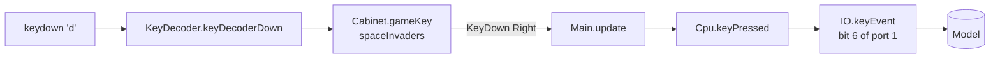

</div>

<div class="grid grid-cols-2 gap-4 code-small">

<div>

```elm
-- src/elm/UI/KeyDecoder.elm (excerpt)
keyDecoderDown =
    keyDecoder |> Decode.andThen (\key ->
        case key of
            ...
            _ ->
                case gameKey spaceInvaders key of
                    Just gameKeyPressed -> Decode.succeed (KeyDown gameKeyPressed)
                    Nothing -> Decode.fail "Pressed key is not an Elmulator shortcut")
```

</div>

<div>

```elm
-- src/elm/Cpu.elm
keyPressed key machineState =
    apply (keyEvent True key machineState) machineState
```

```elm
-- src/elm/IO.elm: Right is bit 6 of port 1
Right ->
    portOneEvent pressed 0x40 machineState
```

</div>

</div>

---
layout: center
---

# Try it out

Play Space Invaders in the browser:
[samuelbucheliz.github.io/elmulator](https://samuelbucheliz.github.io/elmulator)

Read the code, starting with the types:

- `src/elm/Registers.elm`: registers and pairs as types
- `src/elm/Cabinet.elm`: buttons and keys as values
- `src/elm/Cpu.elm`: the core loop and `runCycles`

Run the tests: `npm test` (about a second) and `npm run test:slow` (the CP/M ROMs)

Repository: [github.com/SamuelBucheliZ/elmulator](https://github.com/SamuelBucheliZ/elmulator)
